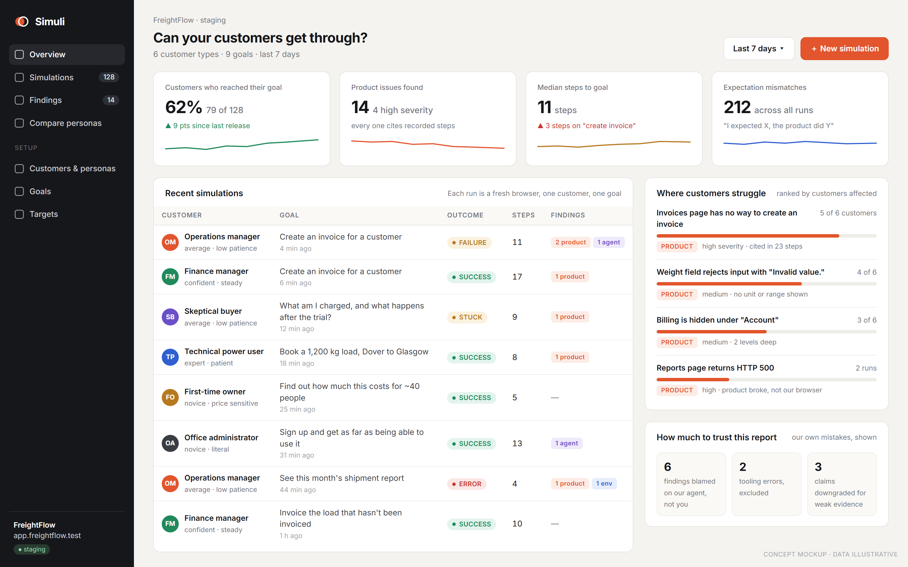
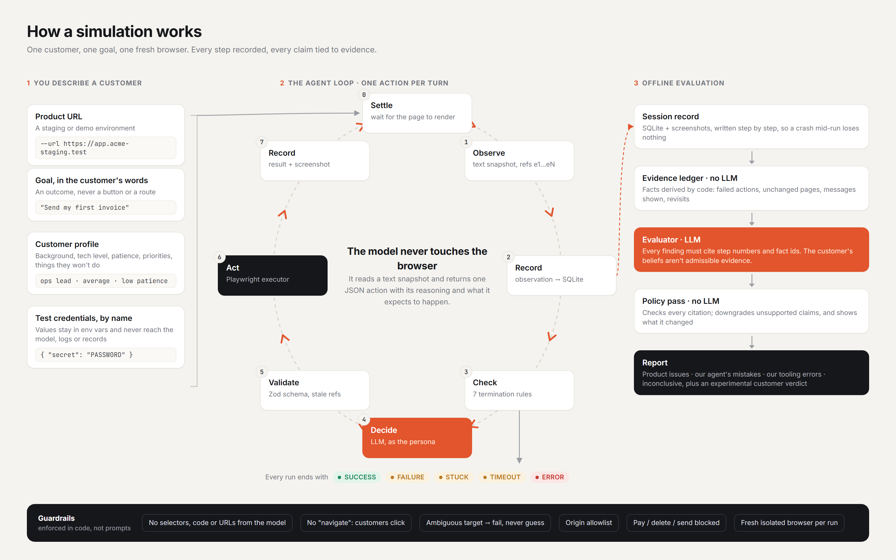
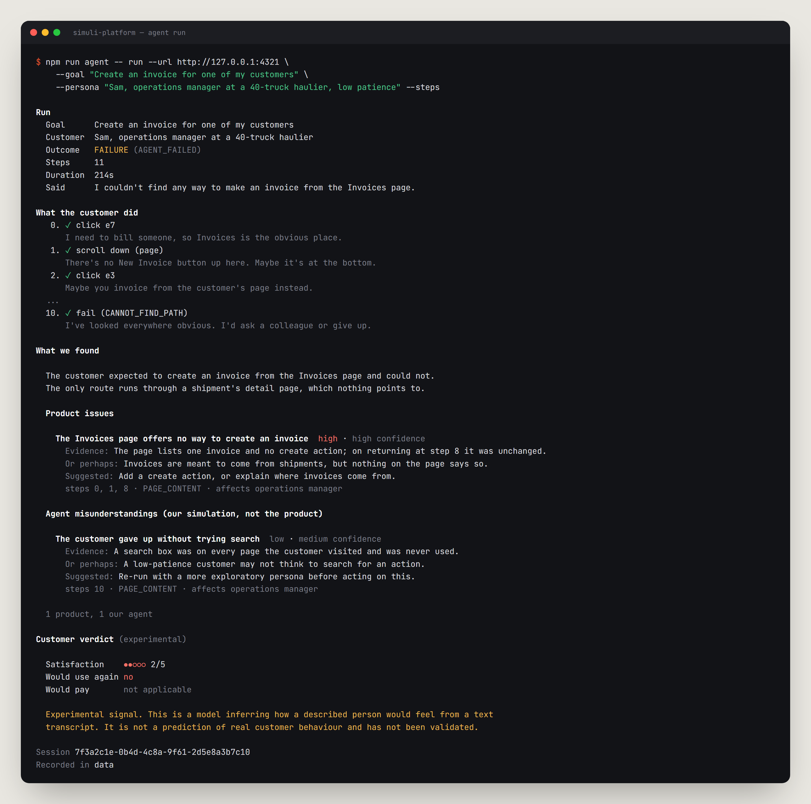
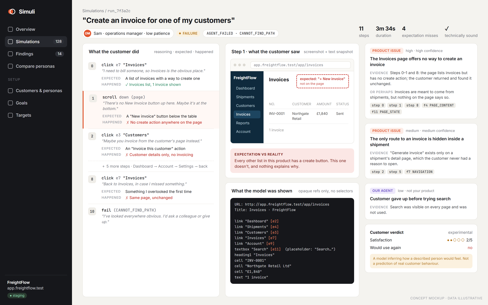
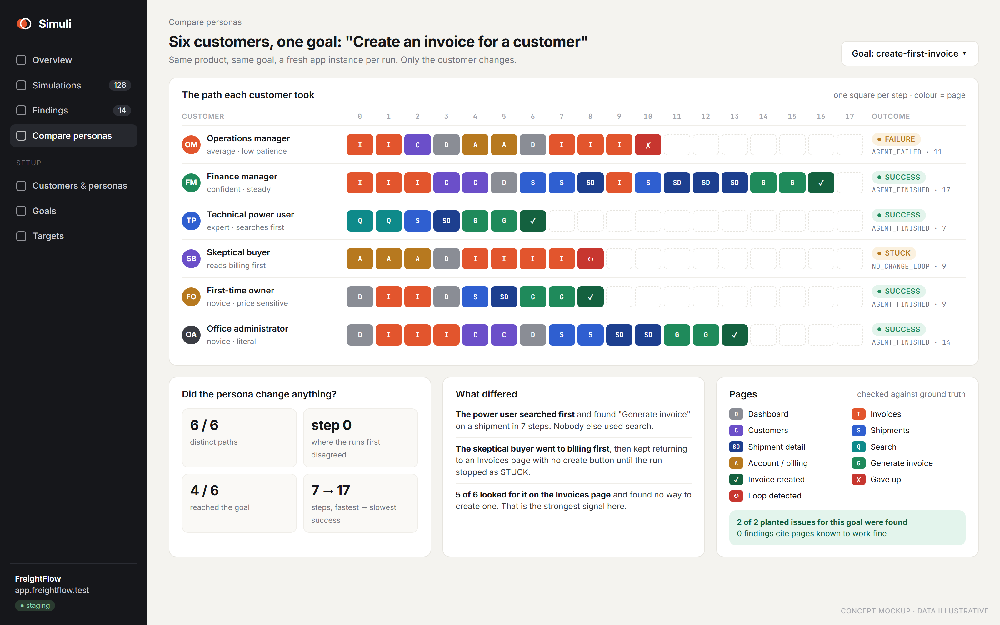

<div align="center">

# Simuli

**Your AI customer base before your real customer base.**

Simuli runs a realistic AI customer through your SaaS product in a real browser,
then tells you whether they got what they came for and what got in their way.




<sub><b>Concept mockup.</b> Simuli is CLI-only today. This dashboard shows where the product is heading, using illustrative data from our FreightFlow test target.</sub>

</div>

---

## Why Simuli

You give us a URL, test credentials, a description of your target customer and
a goal in their own words, such as *"send my first invoice"*. We put an AI
persona of that customer in front of your product. It reads the page, decides
what that person would do next, clicks, types and gets lost the way a real
customer would. Every step is recorded.

**This is not automated QA.**

| | Automated QA | Simuli |
|---|---|---|
| Asks | Does this scripted workflow pass? | Can *this kind of person* succeed here? |
| Input | Selectors and steps | A customer profile and a goal |
| Behaviour | The same path every time | Varies by persona: an impatient ops manager and a careful finance lead take different routes |
| Output | Pass / fail | Outcome, friction points with evidence, and what the customer expected at each step vs what actually happened |

Each action the agent takes records its **reasoning** and its **expectation**.
The gap between what the customer expected and what the product did is the main
friction signal Simuli reports.

## How it works



1. **Settle and observe.** Wait for the page to render, then turn it into a
   compact text snapshot. Every interactive element gets an opaque ref
   (`e7`, `e11`…).
2. **Decide.** The model plays the persona and returns exactly one action from
   a fixed list: `click`, `type`, `select`, `scroll`, `press_key`, `go_back`,
   `wait`, `finish` or `fail`.
3. **Validate and act.** The action is checked against a Zod schema and a
   stale-snapshot guard, then carried out by a Playwright executor that refuses
   destructive actions.
4. **Record.** Observations, actions, results and screenshots are written to
   SQLite step by step, so a crash mid-run loses nothing.
5. **Terminate.** Every run ends with exactly one outcome: `SUCCESS`, `FAILURE`,
   `STUCK`, `TIMEOUT` or `ERROR`. Seven enforced stop conditions mean no run can
   hang.
6. **Evaluate offline.** Code derives an evidence ledger of facts from the
   record. An LLM evaluator writes findings that must cite steps and fact ids.
   A deterministic policy pass then downgrades any claim the evidence doesn't
   support, and the report shows what it changed.

### What a report looks like



<sub>The layout matches the real CLI renderer (<code>src/cli/render.ts</code>). The run content is illustrative.</sub>

Findings are sorted by **whose problem they are**, and Simuli names its own
failures openly:

| Classification | Meaning |
|---|---|
| `PRODUCT_ISSUE` | The product made this hard, or broke. |
| `AGENT_MISUNDERSTANDING` | Our simulated customer got it wrong. Our fault. |
| `ENVIRONMENT_ERROR` | The browser or our tooling failed. Our fault. |
| `INCONCLUSIVE` | Something happened, but the evidence can't say what. |

## Where it's going

The product direction is a UI on top of the same `runSimulation()` library the
CLI uses. **None of the screens below exist yet.** They are design mockups with
illustrative data.

<table>
<tr>
<td width="50%"></td>
<td width="50%"></td>
</tr>
<tr>
<td><b>Session report</b> <i>(concept)</i>: each step's reasoning, expectation and actual result, next to what the customer saw and the exact text the model was given.</td>
<td><b>Persona comparison</b> <i>(concept)</i>: six customers, one goal. Where their paths split, who got through, and whether the persona changed anything at all.</td>
</tr>
</table>

## Quick start

Requirements: **Node.js 24+** and npm. SQLite comes from Node's built-in
`node:sqlite`, so there's no native build step on any platform.

```bash
git clone https://github.com/Maheen-M02/Simuli-platform.git
cd Simuli-platform
npm install
npx playwright install chromium

npm test          # full suite, no API key and no network needed
```

To run against a model, copy `.env.example` to `.env` and set `OPENAI_API_KEY`.
The default endpoint is OpenRouter. Check that your model honours strict
structured output before spending a run on it:

```bash
npm run check:endpoint -- --model openai/gpt-4.1   # must report HONOURED
```

## Usage

### One simulated customer

```bash
npm run agent -- run \
  --url https://app.your-staging.example \
  --goal "Create an invoice for one of my customers" \
  --persona "Ops manager at a 40-person freight firm, not technical, low patience" \
  --steps
```

| Option | Effect |
|---|---|
| `--persona-file <path>` | A JSON persona instead of a one-liner |
| `--max-steps <n>` / `--timeout <s>` | Run limits (default 40 steps, 300 s) |
| `--allow-origin <url>` | Allow navigation to another origin (repeatable) |
| `--headed` | Watch the browser drive itself |
| `--json` | Machine-readable output |
| `--no-evaluate` | Record the run but skip the report |

Exit codes: `0` the customer reached the goal, `1` they didn't, `2` the run
itself broke.

### FreightFlow: a realistic B2B test target

`fixtures/freightflow/` is a small freight-operations SaaS built to test the
agent. It has six materially different personas, nine goals, and a ground-truth
list of planted product problems and known non-issues, which the agent cannot
see.

```bash
npm run fixture:freightflow   # http://127.0.0.1:4321

npm run simulate -- --target freightflow --persona skeptical-buyer --goal find-pricing
npm run compare  -- --target freightflow --goal create-first-invoice   # every persona, scored against ground truth
```

### Against a real application

```bash
cp runs/example.json runs/my-target.json   # state the environment and who authorised it
npm run validate:real -- --config runs/my-target.json --headed
```

The runner won't start without a stated environment (`staging`, `demo`,
`sandbox` or `own-application`) and the name of whoever authorised the run.
Credentials are listed **by name** in the run file and read from
`SIM_SECRET_<NAME>` environment variables. See
[REAL_WORLD_VALIDATION.md](REAL_WORLD_VALIDATION.md).

### Re-evaluate and measure

```bash
npm run eval:session -- <session-id>     # re-judge a recorded run without a browser
npm run eval:golden -- --model <id>      # evaluator precision/recall on 17 golden scenarios
npm run benchmark:models                 # compare two model providers
```

## Guardrails

These are enforced in code, not in the prompt.

- **The model never touches the browser.** It receives text and returns JSON.
  It cannot write selectors, code or URLs; it can only point at refs it was
  shown.
- **No `navigate` action.** Customers reach pages by clicking, so the agent
  can't skip the friction we're trying to measure.
- **Never guess.** If a ref is ambiguous or missing, the action fails. A wrong
  click is worse than a failed one.
- **Destructive actions are blocked** in the executor: pay, purchase, delete,
  send, transfer, subscribe and so on.
- **Origin allowlist.** Navigation outside the target is refused through
  request routing.
- **Secrets stay secret.** The model sees `{"secret": "PASSWORD"}`; the real
  value is substituted inside the executor and never reaches prompts, logs or
  session records. Password fields are never read back.
- **Fresh isolated browser per run.** No shared cookies, storage or profile.

## Project structure

```
src/
  runSimulation.ts   Library entry point; the CLI is a thin wrapper around it
  cli/               Argument parsing, exit codes, report rendering
  actions/           The action schema: the model-output security boundary
  observations/      In-page DOM walk, text serializer, redaction on write
  browser/           Isolated session, ref resolver, enforcing executor
  agent/             Loop, planner, prompt, termination rules
  sessions/          Incremental recorder
  persistence/       node:sqlite store, screenshot artifacts
  evaluation/        Evidence ledger, LLM evaluator, policy pass, verdict
  llm/               The only place model calls are made; providers, usage
  personas/ goals/   Input schemas and customer context
  validation/        Ground truth, behavioural diversity, benchmarks
  logging/           Pino, with redaction configured in exactly one place
fixtures/freightflow/  Realistic B2B evaluation target
tests/                 Unit + integration (Vitest), including the fixture site
scripts/               simulate, compare, real-world runner, golden eval, benchmarks
docs/                  Founder briefing, evaluator baseline, benchmark notes
```

**Stack:** Node.js 24 · TypeScript (strict) · Playwright · Zod · OpenAI SDK
(any OpenAI-compatible endpoint) · node:sqlite · Pino · Vitest.

## Testing

```bash
npm test            # unit + integration (318 tests at the latest commit)
npm run typecheck
```

Tests never call a model and never touch an external website. Unit tests
inject a scripted planner. Integration tests drive a real Chromium against the
local fixture sites (`tests/fixtures/site/` and FreightFlow) and check loop and
executor behaviour, never model judgement.

## Status

**V0 is complete against the local fixtures.** `agent run` drives a real
browser, validates and records every action, ends every run with an explicit
outcome, and produces a SQLite session record plus a schema-validated
evaluation.

**Measured so far:** on the 17-scenario golden set, the `openai/gpt-4.1`
evaluator scored **75% precision and 60% recall** (14 scenarios scored). That
is a baseline, not a target met; see
[docs/evaluator-baseline.md](docs/evaluator-baseline.md).

**Next:** the first model-driven run against a real product, using a staging
target without email verification.

### Known limitations

- Flows that need an email or SMS code, CAPTCHAs, and bot-protected pages are
  out of reach.
- Observation is text-only. Purely visual defects, iframe contents (such as
  Stripe fields) and shadow DOM are invisible to the agent.
- No multi-tab flows and no file upload.
- The **customer verdict** (satisfaction, would-use-again, would-pay) is an
  experimental signal from a model reading a transcript. It is not a prediction
  of real human behaviour, and every report says so next to the number.

## Further reading

- [CLAUDE.md](CLAUDE.md): engineering principles, scope and conventions
- [HANDOVER.md](HANDOVER.md): decisions made and why
- [REAL_WORLD_VALIDATION.md](REAL_WORLD_VALIDATION.md): running against a real application safely
- [fixtures/freightflow/README.md](fixtures/freightflow/README.md): the evaluation target and its ground truth
- [docs/AI-Customer-Simulation-Overview.pdf](docs/AI-Customer-Simulation-Overview.pdf): founder briefing, covering market, competitors and business model
